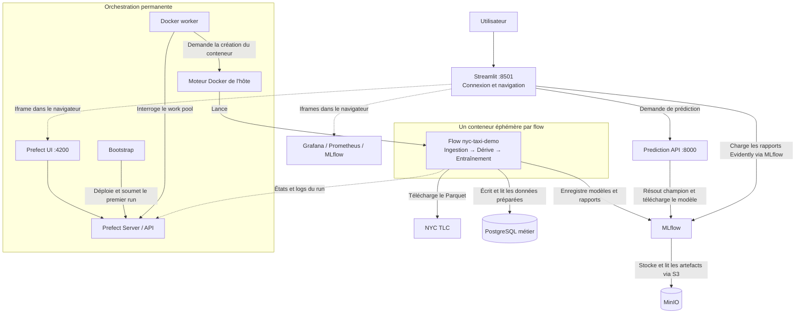
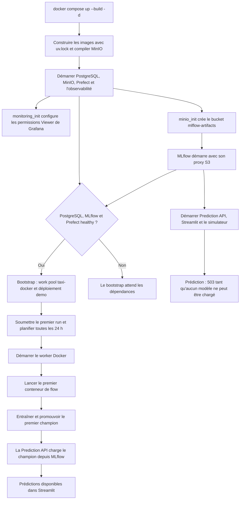
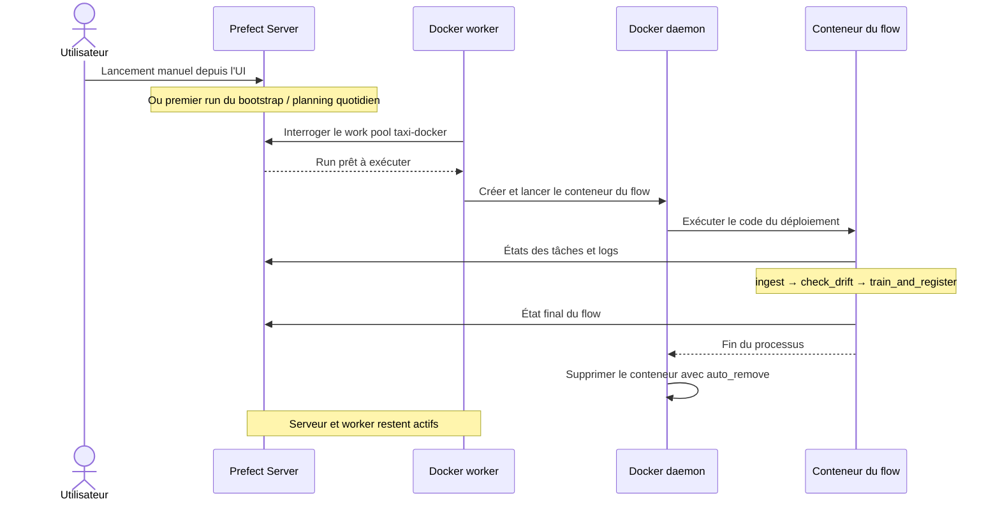
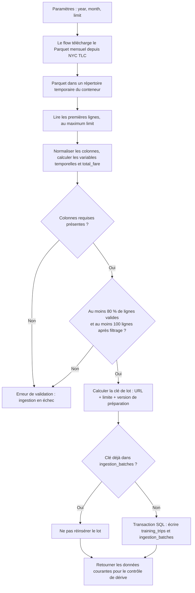
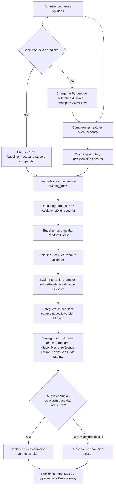
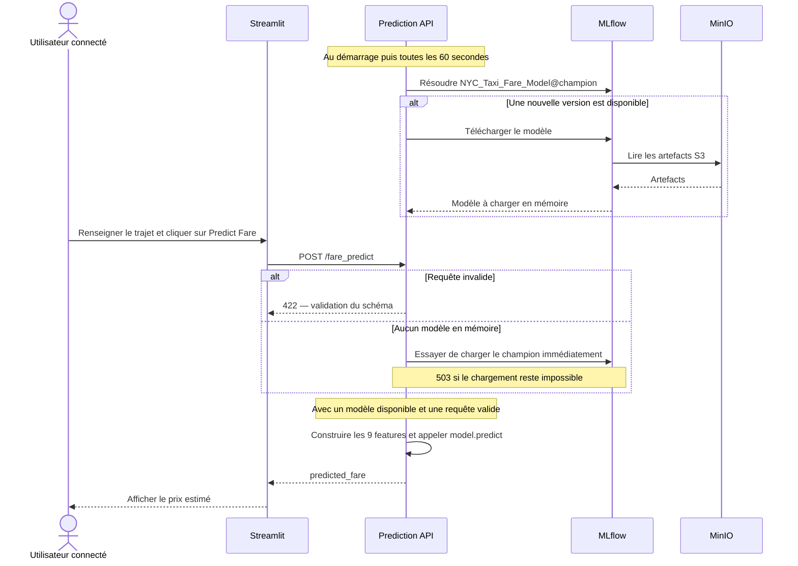
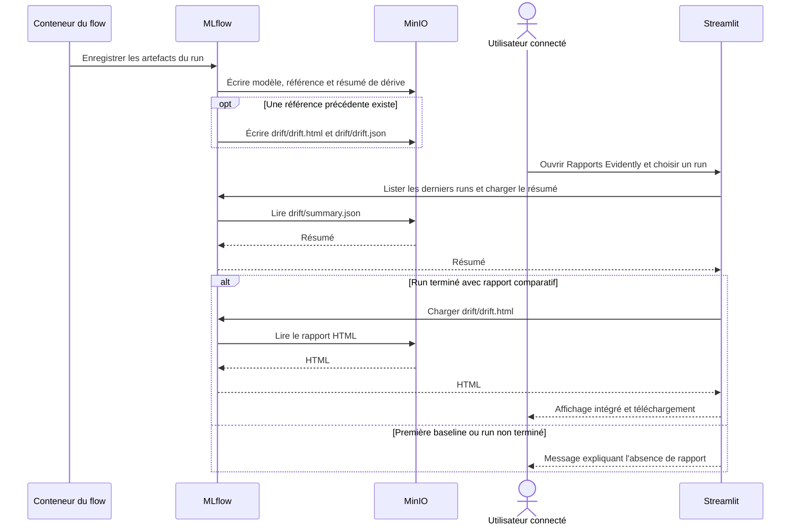
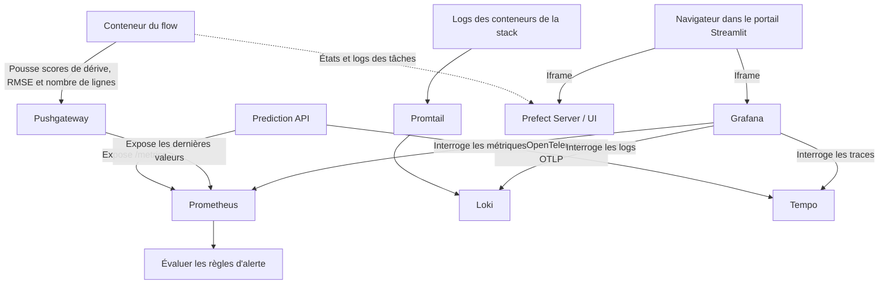

# NYC Taxi — monitoring et observabilité

Démonstration MLOps entièrement démarrée par Docker Compose : téléchargement de
vraies données NYC TLC, contrôles qualité, stockage PostgreSQL, rapport de dérive,
entraînement Random Forest et enregistrement dans MLflow. Les artefacts sont
stockés dans MinIO ; aucun modèle préentraîné n'est embarqué dans le dépôt.

## Lancer la démonstration

Prérequis : Docker Compose et accès au daemon Docker. Internet est nécessaire
pour les images et le téléchargement du Parquet TLC.

```bash
cp .env.example .env
# Renseigner PORTAL_PASSWORD dans .env.
docker compose up --build -d
```

Ouvrir **http://localhost:8501** et se connecter avec `demo` et le mot de passe
choisi. Le portail rassemble prédiction, Prefect, dashboards Grafana, rapports
Evidently, Prometheus et MLflow. Au premier lancement, attendre la fin du flow
Prefect : l'API de prédiction répond 503 tant que le champion n'est pas disponible.

La première construction compile MinIO depuis un tag du code officiel : ses
anciennes images publiques ne sont plus téléchargeables sur les registres
historiques. Cette étape peut prendre plusieurs minutes, puis bénéficie du cache.

## Architecture

- **Prefect Server / UI** (`4200`) : déploiement, planning et état des exécutions.
  Une base SQLite persistante est utilisée pour cette démo locale mono-serveur.
- **Bootstrap** : crée le work pool Docker, le déploiement et le premier run.
- **monitoring_init** : donne au rôle Viewer l’accès au dossier des dashboards Grafana.
- **Worker Docker** : interroge Prefect et lance un conteneur par flow. Les tâches
  tournent dans ce conteneur, supprimé automatiquement à la fin (`auto_remove`).
  Le worker utilise le socket Docker de l'hôte.
- **Flow** : télécharge le Parquet TLC de janvier 2024, prépare jusqu'à
  `DEMO_ROWS=5000` lignes, valide et charge PostgreSQL sans doublons à la relance.
  Compare les nouvelles données à la référence du champion, puis entraîne et
  évalue un candidat. Un planning quotidien permet de rejouer le flow ; les
  paramètres année/mois/limite sont modifiables dans Prefect.
- **PostgreSQL** (`5432`) : données d'entraînement et identifiants d'ingestion.
- **MLflow** (`5000`) : expériences, métriques, versions et alias `champion`.
  Les métadonnées sont dans une SQLite persistante distincte de Prefect.
- **MinIO** (`9000`, console `9001`) : bucket privé `mlflow-artifacts`, créé
  automatiquement. MLflow sert de proxy pour les transferts S3 : les clients
  n'ont ni volume modèle partagé ni identifiants S3 à gérer.
- **Prediction API** (`8000`) : charge le champion depuis MLflow, vérifie les
  changements toutes les 60 secondes et expose `/fare_predict` et `/metrics`.
- **Streamlit** (`8501`) : authentification et navigation de démonstration.
- **Load simulator** : génère le trafic de prédiction.
- **Prometheus** (`9090`) et **Pushgateway** : métriques API et dernier résultat
  du pipeline éphémère. Les règles d'alerte sont évaluées dans Prometheus.
- **Promtail → Loki** (`3100`) : logs Docker. Les logs des flows sont également
  conservés dans Prefect ; l'auto-suppression peut précéder la collecte Promtail.
- **OpenTelemetry → Tempo** (`4317`/`3200`) : traces de la Prediction API.
- **Grafana** (`3000`) : trois dashboards métier, système et diagnostic.

Les services partagent le réseau `nyc-taxi-ml`. Les anciennes Data API,
Training API et boucles ETL ont été remplacées par les tâches Prefect.

## Qualité, dérive et modèles

Des colonnes absentes, moins de 100 lignes valides ou plus de 20 % de lignes
invalides bloquent l'ingestion. Une dérive seule ne bloque pas l'entraînement.
Le candidat et le champion sont comparés sur le même échantillon de validation
(seed fixe, suffisant pour cette démo ; une évaluation temporelle indépendante
serait préférable pour un cas réel). Le candidat n'est promu que si sa RMSE
est inférieure, ou si aucun champion n'existe.

Chaque run MLflow conserve la référence Parquet, les métriques et le résumé de
dérive. Dès le deuxième run, Evidently produit aussi les rapports HTML et JSON,
consultables et téléchargeables dans Streamlit. La référence utilisée est celle
du champion précédent ; elle ne change pas tant que ce champion reste en place.

Les volumes conservent données SQL, métadonnées et objets MinIO après l'arrêt.
`docker compose down` les préserve ; `docker compose down -v` les efface et permet
une démonstration entièrement neuve.

## Comprendre les pipelines

Les flèches sont libellées pour distinguer les **appels** des **données
échangées**. L'ingestion est pilotée par le flow : NYC TLC ne pousse pas les
fichiers vers notre infrastructure.

### Vue d'ensemble : qui pilote quoi ?



Le worker reste actif entre les exécutions. Il **ne contient pas les tâches** :
il lance un autre conteneur utilisant l'image `nyc-taxi-pipeline:demo`. Les tâches
`ingest`, `check_drift` et `train_and_register` s'y exécutent dans cet ordre.

### Au lancement de la stack



`minio_init` et `prefect_bootstrap` sont des services ponctuels : leur état
**Exited (0)** signifie qu'ils ont terminé correctement. Le démarrage du portail
n'attend pas la fin de l'entraînement. Sur un redémarrage avec volumes conservés,
un champion déjà enregistré peut être chargé immédiatement.

### Cycle de vie d'une exécution Prefect



Le déploiement limite à **une exécution simultanée**. Une erreur remonte dans
Prefect ; `ingest` dispose de trois nouvelles tentatives espacées de dix secondes.
Les tâches de dérive et d'entraînement n'ont pas de retry automatique configuré.
Les artefacts déjà écrits dans MinIO et les données SQL survivent au conteneur.

### Ingestion : du Parquet aux données d'entraînement



Le fichier brut temporaire est supprimé après lecture. PostgreSQL conserve les
**variables préparées**, pas le fichier brut. Rejouer les mêmes paramètres ne
réinsère pas le lot ; changer la limite crée une autre clé et peut produire un
échantillon qui recoupe les lignes déjà stockées.

### Dérive, entraînement et promotion du modèle



**Actuellement chaque flow qui passe l'ingestion entraîne un candidat**, même
sans dérive. La dérive est un indicateur, pas une condition de déclenchement ou de
blocage. Le seuil qualité se trouve dans l'ingestion. Les rapports comparatifs
apparaissent dès qu'un champion et sa référence sont disponibles.

La référence de chaque candidat est l'échantillon courant ; le modèle, lui, est
entraîné sur l'ensemble des données SQL. Le contrôle suivant reprend la
référence du **champion**, qui reste stable lorsqu'un candidat n'est pas promu.
La promotion arrive après l'enregistrement des artefacts. Une erreur ultérieure
de publication vers Pushgateway peut donc faire échouer le flow alors que le
modèle a déjà été enregistré et éventuellement promu.

### Prédiction et mise à jour du modèle en mémoire



La prédiction ne lit pas PostgreSQL et ne lance aucun flow Prefect. Le modèle
chargé reste en mémoire entre les requêtes. Si une vérification périodique échoue,
un modèle déjà chargé reste utilisable. Les erreurs d'inférence retournent 500.

### Rapports Evidently : stockage et consultation



Le rapport ne dépend pas de la survie du conteneur d'entraînement. Streamlit le
récupère via MLflow, qui accède au bucket privé MinIO. Le portail affiche les
30 derniers runs de l'expérience.

### Observabilité : trois circuits complémentaires



Prometheus collecte toutes les cinq secondes. Pushgateway conserve le dernier
résultat publié après la disparition du flow : ces valeurs ne représentent pas
un traitement en cours. Prefect reste la source pour le statut des exécutions.
Les règles Prometheus signalent les alertes ; aucun Alertmanager ni envoi de
notification externe n'est configuré. La collecte des traces est actuellement
instrumentée dans la Prediction API.

## Configuration et accès

Les variables `*_UI_URL` sont des adresses accessibles depuis le navigateur.
Pour une présentation depuis un autre ordinateur, remplacer `localhost` par le
nom de l'hôte dans ces variables et dans `PREFECT_BROWSER_API_URL`. Conserver le
même nom d'hôte pour Streamlit et les interfaces embarquées.

L'authentification Streamlit protège le portail uniquement, pas les ports directs.
Grafana autorise les iframes et l'accès anonyme Viewer pour cette démonstration.
MinIO utilise `minioadmin` / `minioadmin` et Grafana `admin` / `admin`. Cette
configuration est destinée à une démo locale et ne constitue pas un SSO.

## Développement et validation avec uv

Les dépendances sont déclarées par groupe dans `pyproject.toml` et figées dans
`uv.lock`. Toutes les images Python utilisent `uv sync --frozen`.

```bash
uv sync --frozen --group pipeline --group frontend --group api --group dev
uv run --no-sync pytest -q
PORTAL_PASSWORD=validation-only docker compose config --quiet
# Après le démarrage, vérification réelle MLflow / MinIO / prédiction :
uv run --no-sync python scripts/verify_demo.py
# Vérifier accès anonyme, requêtes des dashboards, logs et traces :
uv run --no-sync python scripts/verify_monitoring.py
```

Le script de vérification attend le premier modèle, contrôle sa présence dans
MinIO, demande une prédiction, puis lance un deuxième flow pour vérifier le
rapport Evidently. Il nécessite la démo en cours sur les ports par défaut.
