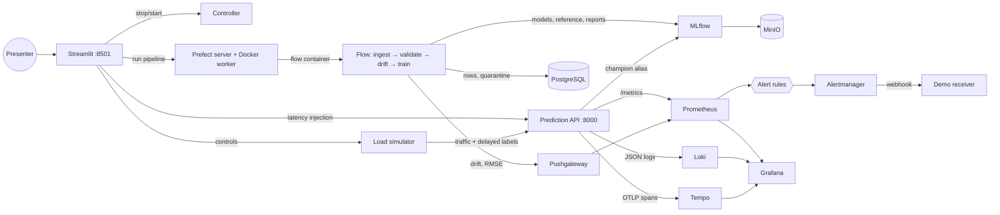
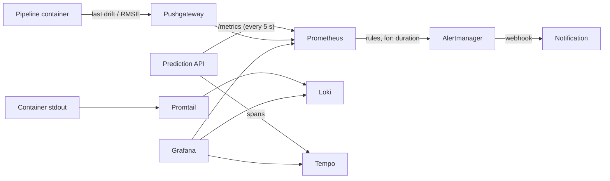
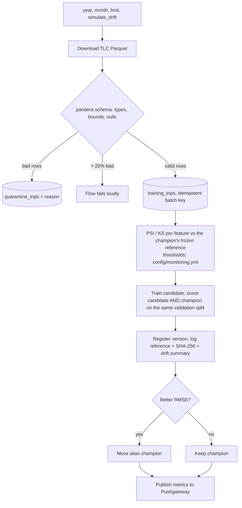
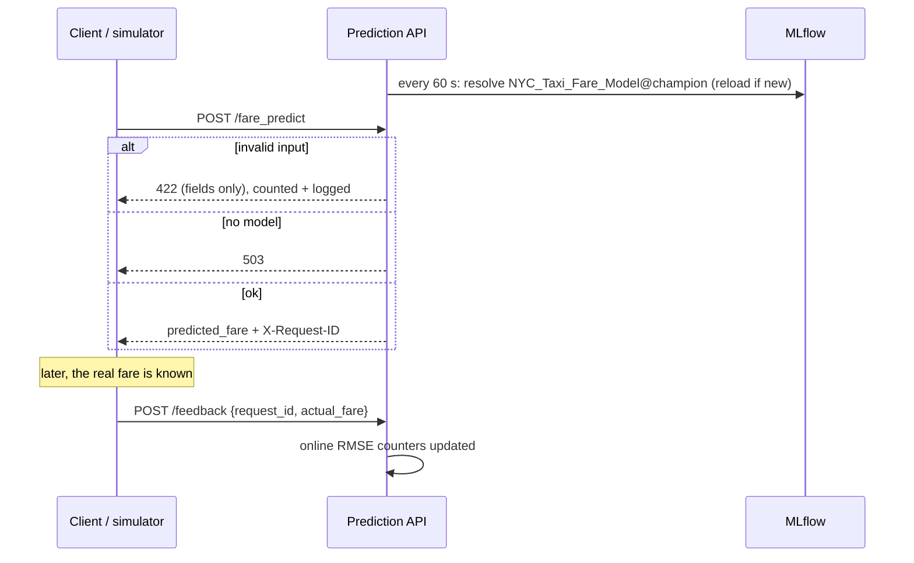

# NYC Taxi — ML monitoring & observability masterclass

A fare-prediction service you can **break on purpose** and watch from three angles: metrics (Prometheus/Grafana),
logs (Loki) and traces (Tempo), with alerts delivered through Alertmanager. Everything starts with one command.
The centre of the demo is the **Streamlit portal**: one page per use case, each with a trigger, live monitoring and
observability, in English.

Before every session open [`DEMO_CHECKLIST.md`](DEMO_CHECKLIST.md): it tracks what is verified and how.

## Quick start

Prerequisites: Docker with Compose v2 (daemon access) and internet (images + NYC TLC Parquet). For the tests: [uv](https://docs.astral.sh/uv/).

```bash
make up      # creates .env from .env.example if missing, builds and starts everything
make down    # stops everything (data is kept)   ·   make reset  # stops and erases all data
```

First start: wait for the first Prefect run to finish (~2 min). The API answers 503 and `/health` is red until a champion model exists.
The first build also compiles MinIO from its official source tag (public images are no longer published): several minutes, then cached.

### URLs and demo credentials

| Tool | URL | Login |
|---|---|---|
| **Streamlit portal** (start here) | http://localhost:8501 | `demo` / value of `PORTAL_PASSWORD` in `.env` |
| Grafana | http://localhost:3000 | `admin` / `GRAFANA_ADMIN_PASSWORD` (anonymous Viewer is enabled for the iframes) |
| Prometheus | http://localhost:9090 | – |
| Alertmanager | http://localhost:9093 | – |
| MLflow | http://localhost:5000 | – |
| Evidently reports | in the portal (**Deep dive → Evidently reports**), stored in MLflow/MinIO | portal login |
| Prefect | http://localhost:4200 | – |
| MinIO console | http://localhost:9001 | `MINIO_ROOT_USER` / `MINIO_ROOT_PASSWORD` |
| Prediction API | http://localhost:8000 (`/health`, `/metrics`, `/docs`) | – |
| Demo alert receiver | http://localhost:8020/alerts | – |

`.env.example` ships **demo-only** values (`demo-change-me`). `.env` is git-ignored; no secret lives in the repository.
Change every password before exposing a port beyond localhost.

## The story (Streamlit pages)

Each page follows the same rhythm: **story → trigger → monitoring (what the numbers say) → observability (why)**.
Use *Start here → Reset to a healthy baseline* between stories.

| Page | You do | You see | Alert |
|---|---|---|---|
| 1 · A normal day | quote a fare | RED metrics; the request's own log line via its `request_id` | none |
| 2 · A slow service | inject 1.5 s latency | p50/p95/p99 vs the 1 s line, slowest traces, slow log lines | `HighLatencyP99` |
| 3 · Data drift | run the pipeline on shifted data | PSI per feature vs threshold, dataset flag | `DataDriftDetected` |
| 4 · Bad data | raise the share of invalid requests | 422s climb, 5xx stays 0; logs name the fields | none (on purpose) |
| 5 · An outage | stop the API | `up`→0, `/health` unreachable, notification, recovery | `ServiceDown` |
| 6 · Model quality | real fares jump +100% | online RMSE vs validation RMSE | `OnlineModelErrorHigh` |
| 7 · Business impact | traffic collapses | quotes/min and revenue/min | `BusinessThroughputLow` |

Other sections: **Observe** (alerts & notifications, logs & traces, Grafana dashboards) and **Deep dive**
(Prefect, MLflow, Evidently, Prometheus, Alertmanager, manual prediction) keep the full tools one click away through iframes.

## Scripted scenarios (no browser needed)

```bash
make demo-normal       # normal traffic → no alert for 90 s
make demo-latency      # HighLatencyP99
make demo-drift        # DataDriftDetected
make demo-outage       # ServiceDown
make demo-performance  # OnlineModelErrorHigh (bonus)
make demo-business     # BusinessThroughputLow (bonus)
```

Each script injects the fault, queries the Prometheus and Alertmanager APIs and the webhook, prints the measured delay
(seconds since injection), removes the fault and waits for the alert to resolve. Measured delays are recorded in `DEMO_CHECKLIST.md`.

## Architecture



### Observability circuits



Logs and metrics are linked by the **`request_id`** (returned in the `X-Request-ID` response header, present in every
log line with `trace_id` and `model_version`). Loki labels stay low-cardinality; ids are fields inside the JSON line.

### Pipeline (Prefect flow `nyc-taxi-demo`)



### Prediction and delayed labels



## What is monitored, and where it is defined

| Concern | Where |
|---|---|
| RED metrics, latency histogram (p50/p95/p99), bounded labels | `services/prediction_api/app.py` |
| Real `/health` (loads model **and** runs a smoke prediction) | same file, `GET /health` |
| Input validation (API) | Pydantic bounds → 422 + `invalid_requests_total` |
| Input validation (batch) | `services/pipeline/taxi_validation.py` (pandera), bad rows quarantined |
| Drift thresholds | `config/monitoring.yml` (PSI ≥ 0.2, KS ≥ 0.2, ≥ 30% features) |
| Frozen reference | MLflow artifact of the champion run + `reference_sha256` tag |
| Alert rules | `services/prometheus/alert_rules.yml`, unit-tested with promtool |
| Runbooks | `docs/RUNBOOKS.md` (each alert links to its section) |
| Alert routing | `services/alertmanager/alertmanager.yml` → demo webhook |
| Dashboards (provisioned from files) | `services/grafana/dashboards/` — **L0 “Is it OK?”** first, then L1/L2/L3 |
| Scrape interval | 5 s (demo choice; rule windows are 1 m, ≥ 12× the interval) |

There is no LLM/RAG component in this demo, so LLM-specific checks are not applicable (see `DEMO_CHECKLIST.md`).

## Tests

```bash
uv sync --frozen --group pipeline --group frontend --group api --group dev
uv run --no-sync pytest -q              # unit + portal + promtool rule tests (+ integration if the stack is up)
RUN_SCENARIOS=1 uv run --no-sync pytest tests/test_integration.py   # + end-to-end alert scenarios
```

Unit tests cover validation, drift (no drift / injected drift / thresholds read from config), the API contract,
alert-rule structure and the portal pages. Integration tests send traffic to the running stack and check Prometheus.

## Fault-injection endpoints (demo only)

`PUT /admin/chaos` on the API adds artificial latency and is **disabled unless `CHAOS_ENABLED=true`**.
The `controller` service can only stop/start `prediction_api` (allow-list) through the Docker socket, and publishes no port.
Do not ship either to a real environment.

## Notes and limits

- Pushgateway keeps the last pipeline result, so drift/RMSE gauges describe the **last run**, not "now". The drift alert clears after a run without drift.
- Delayed labels in the demo are **synthetic** (prediction + noise, plus bias when triggered).
- Random 80/20 validation is fine for a demo; a real project should use a temporal split.
- Dashboard viewers are anonymous and Streamlit login protects the portal only, not the direct ports.
- Variables ending in `_UI_URL` are browser-facing: replace `localhost` by the host name when presenting from another computer.
